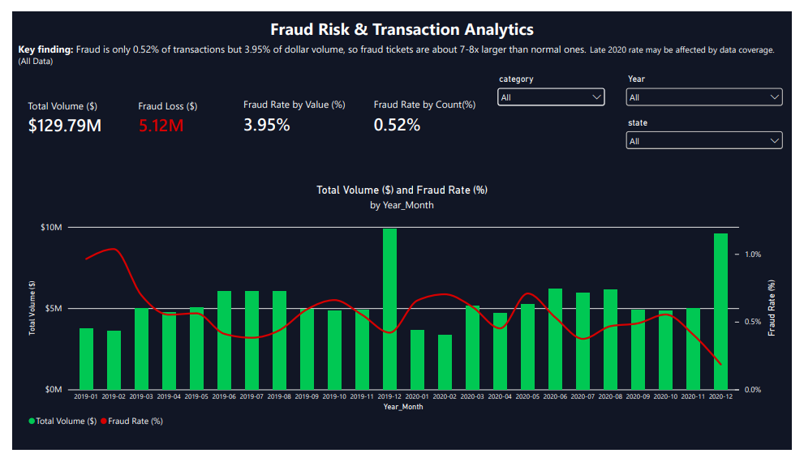
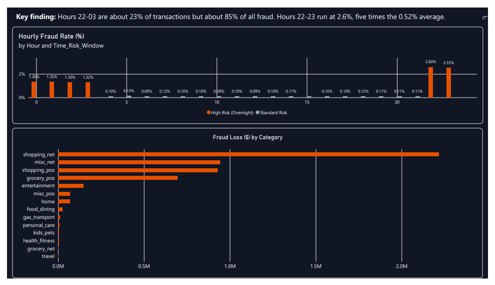
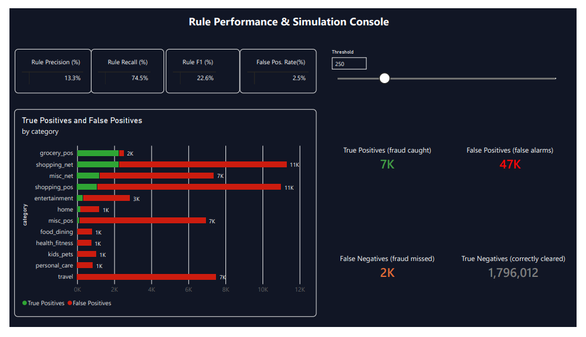
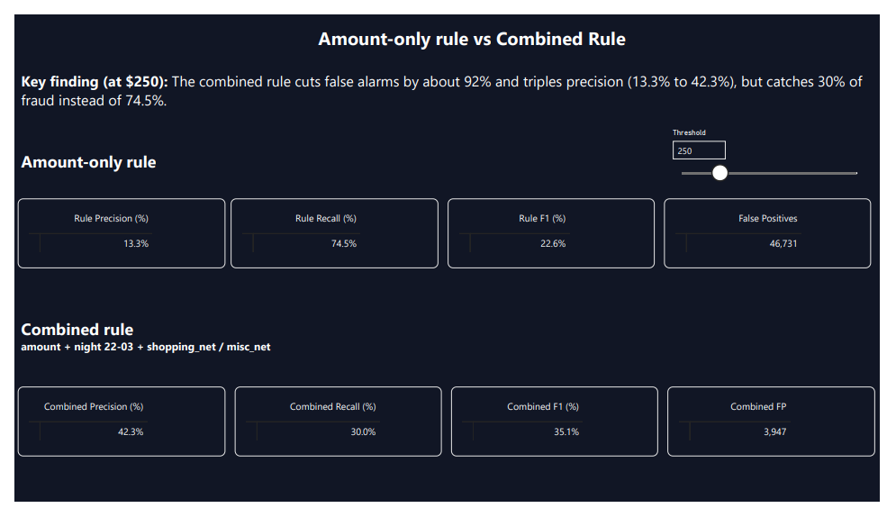
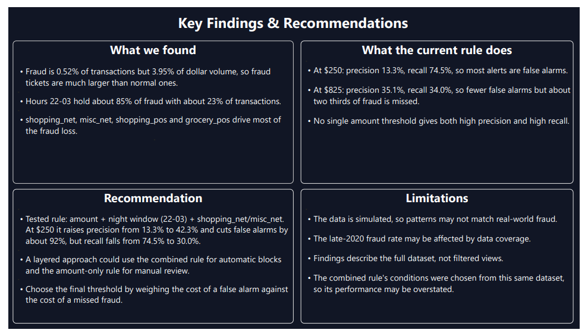

# Fraud Risk & Transaction Analytics

## About this project

I built this project using the Credit Card Transactions Fraud Detection dataset (public dataset on Kaggle by kartik2112, ~1.85 million transactions from 2019-2020) to practice fraud analysis on a large, messy dataset and figure out where fraud actually concentrates in a transaction stream.

I designed the full database schema myself in MySQL (a 3-table normalized schema built from a single flat CSV, with primary and foreign keys), loaded close to 2 million rows, and wrote all the analysis queries using CTEs and window functions.

**Quick stats:** 1.85M transactions analyzed · 0.52% fraud rate overall · fraudulent transactions average 7.8x larger ($530 vs $68) · a $250+ amount threshold alone catches 74.5% of fraud · combining it with time and category cuts false alarms by ~92%.

## From flat file to schema

The raw data comes as one wide table — cardholder info, merchant info, and transaction info all mixed into 22 columns, with no relational structure. Before writing a single analysis query, I had to design a proper schema: a `customers` table, a `merchants` table (with a surrogate `merchant_id`, since merchant names alone aren't a safe key), and a `transactions` table linking the two. I loaded the raw CSVs into a staging table first, then split them into the three normalized tables with `GROUP BY` and `INSERT...SELECT`.

## Key findings

- **Online categories carry far more fraud risk than in-person ones**: `shopping_net` (1.59%) and `misc_net` (1.30%) run 3-7x the fraud rate of most other categories.
- **Fraud spikes hard overnight**: hours 22:00-03:00 run at 1.3-2.6% fraud, roughly 15-20x the daytime rate.
- **Fraudulent transactions are much larger on average**: $530.66 vs. $67.65 for legitimate ones, about 7.8x bigger.
- **Geography is a weak signal**: once I filtered out small-sample states, the spread across states was modest (0.38%-0.75%), nothing dramatic.
- **976 of 999 cardholders (98%) were hit by fraud at least once** — fraud is spread across almost the entire customer base, not concentrated on a vulnerable few.
- **Individual merchants aren't the risk driver — their category is**: the riskiest merchants just track their category's average fraud rate.
- **No real seasonality month to month**: the fraud rate mostly moves inversely with transaction volume (a December volume spike dilutes the rate rather than fraud actually dropping).
- **Category and hour interact**: `misc_net` between 22:00-23:00 hits ~23% fraud, while `grocery_pos` instead peaks at 00:00-03:00 (~2.7%) — this explained why `grocery_pos` looked like an outlier in the category-only breakdown.
- **There's a sharp break in fraud rate at the $250 transaction mark**: under 0.2% below it, ~7.8% between $250-499, ~21-22% above $500.

*(Note: a few of these — merchant level, state level, and customer level — looked like strong patterns at first glance, but turned out to be driven entirely by category and amount once I checked sample sizes and cross-tabulated. Reporting that a dimension doesn't matter, once I'd actually checked it, felt more honest than forcing a story onto it.)*

## Turning findings into a rule

Findings are only useful if they can be acted on, so I built two candidate detection rules and measured what each one actually costs:

- **Amount ≥ $250 alone**: catches 74.5% of fraud, but only 13.3% of what it flags is actually fraud (46,731 false alarms).
- **Amount + overnight window (22:00-03:00) + `shopping_net`/`misc_net`**: cuts false alarms by ~92% and triples precision to 42.3%, but only catches 30.0% of fraud.

Neither rule wins outright — it's a genuine trade-off between how many false alarms a team can absorb versus how much fraud they're willing to miss. I'd lean toward a layered setup: the combined rule for automatic review, the amount-only rule as a lighter second pass. One honest caveat: I tuned both rules by looking at this same dataset, so these numbers are a best case — a real deployment would need to validate against data the rule hasn't seen.

## Dashboard

I built a 5-page Power BI dashboard on top of this analysis, connecting directly to the MySQL database rather than exporting query results into static charts. This meant writing the fraud-rate, rule-precision/recall, and confusion-matrix logic natively in DAX, including an interactive what-if threshold slider that recalculates the rule's performance live.

The dashboard includes:
- **Executive Overview** — KPI cards (total volume, fraud rate by count/value, fraud loss) and a monthly volume vs. fraud rate trend
- **Fraud Concentration** — hourly fraud rate with the overnight risk window highlighted, and fraud loss by category
- **Rule Simulator** — an interactive amount threshold slider driving a live precision/recall/F1 and confusion matrix
- **Rule Comparison** — the amount-only rule set side by side against the combined rule
- **Key Findings & Recommendations** — the whole analysis summarized for a non-technical reader

## Data loading notes

A few real issues came up while loading ~1.85M rows that I had to work through directly:
- `long` is a reserved word in MySQL, so I renamed the coordinate columns to `latitude`/`longitude` instead.
- The CSVs carried a hidden, unnamed pandas index column as the first field, which shifted every column over by one and caused load errors until I added a throwaway variable to absorb it.
- The dates loaded fine in Excel's display but the raw text was ISO format (`YYYY-MM-DD HH:MM:SS`), not the `DD-MM-YYYY` format Excel showed — I had to correct the `STR_TO_DATE` format string after the first load attempt failed.
- MySQL's default InnoDB buffer pool (128 MB) was far too small for a 1.85M-row table, which made every analysis query painfully slow. Raising it to 2 GB and adding a few targeted indexes brought query times down from several minutes to a few seconds.

## Tools used

- MySQL 8.0
- SQL: CTEs, window functions (RANK, SUM OVER), conditional aggregation (SUM on a 0/1 flag), composite indexing
- Power BI: DAX measures, what-if parameters, interactive slicers

## Files

- `sql/fintech_risk_analytics.sql` — full schema, data loading notes, and all 11 analysis queries with comments explaining the finding each one produced
- `dashboard/Fintech_Fraud_Risk_Dashboard.pbix` — Power BI dashboard file, connected directly to the MySQL database
- `dashboard/Fintech_Fraud_Risk_Dashboard.pdf` — static export of the full dashboard
- `dashboard/screenshots/` — individual page screenshots, shown above
